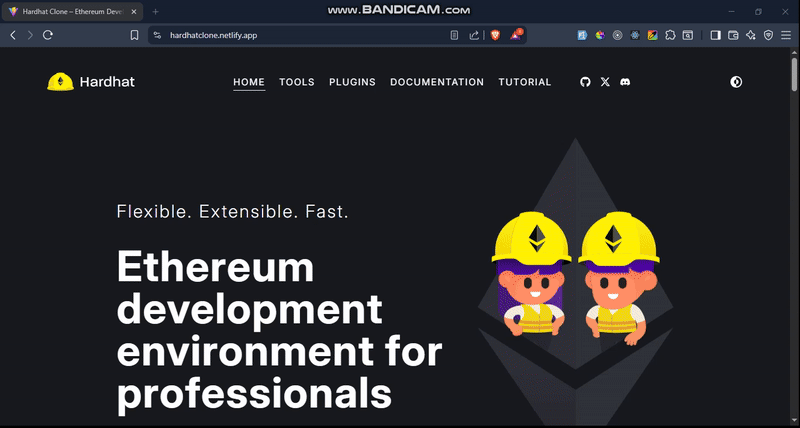

# ⚡ Hardhat Clone

A fully responsive **clone of the official Hardhat website**, built with **React 19, TypeScript, Tailwind CSS 4, and React Router**.  
This project replicates the look and feel of the Hardhat documentation site, while also focusing on clean code, scalability, and modern best practices.

## 🎥 Demo



## 💡 Features

- ⚛️ **Modern Frontend** — Built with React 19 + TypeScript for type-safety and maintainability.
- 🎨 **Tailwind CSS 4** — Utility-first styling for rapid development and consistent design.
- 🌗 **Dark/Light Mode** — Theme toggle using React Context.
- 📚 **Documentation Pages** — Supports nested routes, hash-based navigation, and sidebar menus.
- 🔌 **Plugins Section** — Dynamic plugin details rendering with reusable layouts.
- 🧭 **Tutorial Section** — Step-by-step pages with sidebar navigation.
- 📱 **Responsive Design** — Works seamlessly on desktop, tablet, and mobile.
- ⚡ **Optimized Build** — Vite for fast dev server and production bundling.
- 🔍 **SEO-Friendly** — Metadata and semantic HTML structure for better discoverability.

## 🛠️ Tech Stack

  
  
  
  
  


**UI Enhancements:**  
  
  


## 🏁 Getting Started

Follow these steps to run the project locally:

1. **Clone the repository:**
   ```bash
   git clone https://github.com/Umairulislam/hardhat-clone.git
   cd hardhat-clone
   ```
2. **Install dependencies:**
   ```bash
   npm install
   ```
3. **Start the development server:**
   ```bash
   npm run dev
   ```
4. **Open your browser:**
   Navigate to `http://localhost:5173` to see the project in action.

## 📜 License

This project is for educational purposes only.
All rights for the original Hardhat website design belong to the [Nomic Foundation](https://hardhat.org/).

## 👨‍💼 Author

Crafted with care by **Engr. Umair Ul Islam**
